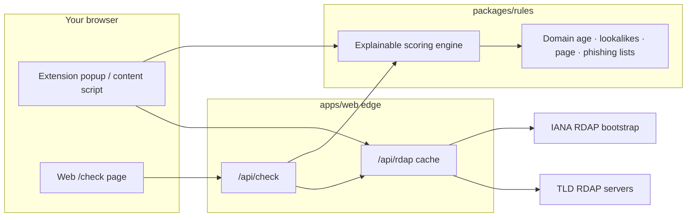

# LegitLens

**by Qurtuba Labs · powered by [Codinito](https://www.codinito.com)**

> A free, open-source anti-scam & fake-shop browser extension **and** web link checker.
> A second opinion before you pay — explainable signals, never “this is a scam.”

[](https://github.com/MuhammadDev-OP/legitlens/actions/workflows/ci.yml)
[](./LICENSE)
[](https://www.codinito.com)

<!-- Screenshot / GIF placeholders — replace with real captures after first release -->
<p align="center">
  
  &nbsp;
  
</p>

## What it does

LegitLens scores a domain and (in the extension) on-page cues, then shows a neutral verdict:

| Verdict | Meaning |
| --- | --- |
| **Looks OK** | No elevated risk signals from the rules we ship |
| **Be careful** | Signals suggest caution — verify before you pay |
| **High risk** | Multiple strong signals; treat with high caution |

Locales first: **English** and **Urdu** (Arabic + Hindi strings included for v1 polish).

## Privacy promise

- **Only the domain name** is sent for RDAP age lookup.
- Page DOM is scanned **locally** in the content script — nothing else is uploaded.
- **No browsing history stored.** No accounts. No ads.

See [Privacy](apps/web/src/app/privacy/page.tsx) / the live `/privacy` page.

## How it works



## Signals (v1)

| Signal | Source | Notes |
| --- | --- | --- |
| Domain age & registrar | RDAP via [IANA bootstrap](https://data.iana.org/rdap/dns.json) | No API key. Very new domains weigh more. |
| Brand lookalikes | Bundled brand subset | Edit distance, homoglyphs, punycode, brand+shop words |
| Page cues | Content-script DOM only | myshopify patterns, 70%+ discounts, missing trust pages, crypto/bank-only wording, countdown pressure |
| Phishing lists | **MIT only** | [Phishing.Database](https://github.com/Phishing-Database/Phishing.Database), [destroylist](https://github.com/phishdestroy/destroylist). **Never** OpenPhish or Google Safe Browsing. |

Every point maps to a human-readable reason string (i18n keys). Wording stays neutral so honest small shops are not defamed.

## Monorepo

```
apps/extension   WXT · Manifest V3 · React popup, badge, checkout banner, WhatsApp “Ask my family”
apps/web         Next.js App Router · landing, /check, privacy, guides, /api/rdap + /api/check
packages/rules   Pure TypeScript scoring engine + Vitest fixtures
```

Package manager: **pnpm** workspaces. TypeScript strict.

## Install from source

### Prerequisites

- Node.js 20+
- pnpm 9 (`corepack enable && corepack prepare pnpm@9 --activate`)

### Setup

```bash
pnpm install
pnpm --filter @legitlens/rules build
```

### Web checker

```bash
pnpm dev:web
# http://localhost:3000/check
```

### Browser extension (unpacked)

```bash
# In one terminal, run the web app so /api/rdap is available (or set WXT_API_BASE)
pnpm dev:web

# In another:
pnpm dev:extension
# or a production build:
pnpm --filter @legitlens/extension build
```

Then in Chromium:

1. Open `chrome://extensions`
2. Enable **Developer mode**
3. **Load unpacked** → select `apps/extension/.output/chrome-mv3` (or the path WXT prints)
4. Pin LegitLens and open the popup on any tab

Firefox: load the temporary add-on from the `.output/firefox-mv3` directory WXT generates.

### Tests & CI locally

```bash
pnpm lint
pnpm typecheck
pnpm test
pnpm build
```

## Contributing

See [CONTRIBUTING.md](./CONTRIBUTING.md), [CODE_OF_CONDUCT.md](./CODE_OF_CONDUCT.md), and [docs/ROADMAP.md](./docs/ROADMAP.md) (includes 10+ good first issues).

Security reports & threat model: [SECURITY.md](./SECURITY.md).

**Maintainer note:** protect `main` with required PRs + required CI / CodeQL / gitleaks checks (details in SECURITY.md). Muhammad applies branch protection in GitHub settings.

## Licence

[AGPL-3.0](./LICENSE) — open source, share-alike for network use.

Data attributions: [NOTICE](./NOTICE).

---

**LegitLens** · by Qurtuba Labs · powered by [Codinito](https://www.codinito.com)  
Portfolio showcase by [Muhammad Bangash](https://github.com/MuhammadDev-OP) — free forever for v1 (no paid tiers, no invented stats).
