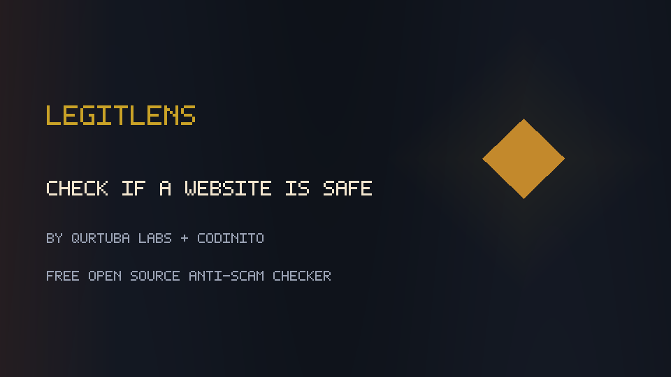
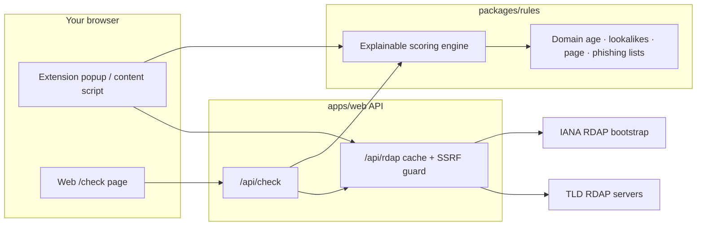

# LegitLens

**Free open-source scam & fake-shop checker** — browser extension + web tool to **check if a website is legit**, spot **phishing** lookalikes, and get a second opinion before you pay. Built for privacy: only the domain leaves the browser (RDAP age lookup). Neutral verdicts (“signals suggest caution”), never “this is a scam.”

**by Qurtuba Labs · powered by [Codinito](https://www.codinito.com)** · portfolio by [Muhammad Bangash](https://github.com/MuhammadDev-OP)

[](https://github.com/MuhammadDev-OP/legitlens/actions/workflows/ci.yml)
[](https://github.com/MuhammadDev-OP/legitlens/actions/workflows/gitleaks.yml)
[](https://github.com/MuhammadDev-OP/legitlens/actions/workflows/codeql.yml)
[](./LICENSE)
[](./tsconfig.base.json)
[](./apps/web)
[](https://www.codinito.com)

<p align="center">
  
</p>

<p align="center">
  
  &nbsp;
  
</p>

## Why LegitLens

Online shoppers keep asking **“is this website legit?”**, **“is this a scam?”**, and **“how do I check if a website is safe?”** Fake outlets, cloned Shopify themes, and lookalike domains are everywhere — and most “trust” widgets hide their rules.

LegitLens is different:

- **Explainable** — every point maps to a human-readable reason (EN + UR first)
- **Privacy-first** — page analysis stays local; only the domain is sent for RDAP
- **Honest marketing** — no invented user counts, star ratings, or paid tiers in v1
- **Open rules** — scoring lives in `packages/rules` under **AGPL-3.0**
- **Security-minded** — minimal MV3 permissions, SSRF-safe RDAP proxy, gitleaks/CodeQL in CI

Use the **web checker** or load the **Chrome/Chromium extension** from source.

## What it does

| Verdict | Meaning |
| --- | --- |
| **Looks OK** | No elevated risk signals from the rules we ship |
| **Be careful** | Signals suggest caution — verify before you pay |
| **High risk** | Multiple strong signals; treat with high caution |

## Privacy promise

- **Only the domain name** is sent for RDAP age lookup.
- Page DOM is scanned **locally** in the content script — nothing else is uploaded.
- **No browsing history stored.** No accounts. No ads. No telemetry.

See the live `/privacy` page.

## How it works



## Signals (v1)

| Signal | Source | Notes |
| --- | --- | --- |
| Domain age & registrar | RDAP via [IANA bootstrap](https://data.iana.org/rdap/dns.json) | No API key. Very new domains weigh more. |
| Brand lookalikes | Bundled brand subset | Edit distance, homoglyphs, punycode, brand+shop words |
| Page cues | Content-script DOM only | myshopify patterns, 70%+ discounts, missing trust pages, crypto/bank-only wording, countdown pressure |
| Phishing lists | **MIT only** | [Phishing.Database](https://github.com/Phishing-Database/Phishing.Database), [destroylist](https://github.com/phishdestroy/destroylist). **Never** OpenPhish or Google Safe Browsing. |

## Monorepo

```
apps/extension   WXT · Manifest V3 · React popup, badge, checkout banner, WhatsApp “Ask my family”
apps/web         Next.js App Router · landing, /check, privacy, guides, /api/rdap + /api/check
packages/rules   Pure TypeScript scoring engine + Vitest fixtures
```

Package manager: **pnpm** workspaces. TypeScript strict.

## Install from source

### Prerequisites

- Node.js 20+
- pnpm 9 (`corepack enable && corepack prepare pnpm@9 --activate`)

### Setup

```bash
pnpm install
pnpm --filter @legitlens/rules build
```

### Web checker

```bash
pnpm dev:web
# http://localhost:3000/check
```

### Browser extension (unpacked)

```bash
pnpm dev:web          # RDAP proxy
pnpm dev:extension    # or: pnpm --filter @legitlens/extension build
```

Then in Chromium: `chrome://extensions` → Developer mode → **Load unpacked** → `apps/extension/.output/chrome-mv3`.

### Tests & CI locally

```bash
pnpm lint && pnpm typecheck && pnpm test && pnpm build
pnpm audit --prod --audit-level=high
```

## Contributing

See [CONTRIBUTING.md](./CONTRIBUTING.md), [CODE_OF_CONDUCT.md](./CODE_OF_CONDUCT.md), and [docs/ROADMAP.md](./docs/ROADMAP.md).

Security & threat model: [SECURITY.md](./SECURITY.md).

**Maintainer note:** protect `main` with required PRs + required CI / CodeQL / gitleaks checks (details in SECURITY.md).

## Licence

[AGPL-3.0](./LICENSE) — open source, share-alike for network use.

Data attributions: [NOTICE](./NOTICE).

---

**LegitLens** · by Qurtuba Labs · powered by [Codinito](https://www.codinito.com)  
Free forever for v1 — no paid tiers, no invented stats.
